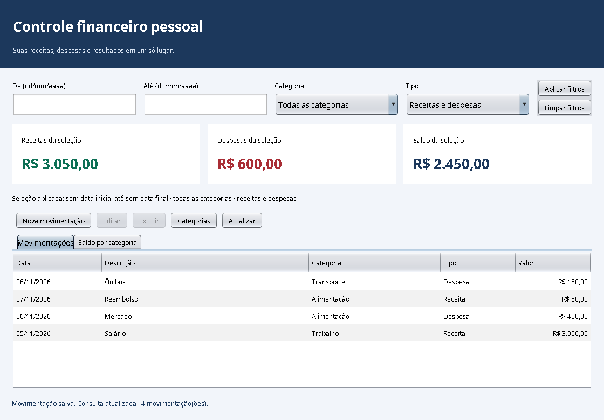

# Sistema de controle financeiro pessoal

Aplicação desktop em Java para registrar receitas e despesas, organizar categorias e consultar o saldo geral e por categoria. Os registros ficam em um banco MySQL local e continuam disponíveis depois que o programa é fechado.

O projeto usa os conteúdos de modularização, listas, orientação a objetos e integração com banco estudados em aula. O SQL fica explícito nas classes DAO, para que seja possível acompanhar o caminho de uma informação da tela até a tabela no MySQL.



## O que o sistema faz

| Área | Funcionamento |
|---|---|
| Movimentações | Cadastrar, consultar, editar e excluir receitas e despesas. |
| Categorias | Cadastrar, renomear e excluir categorias sem movimentações vinculadas. |
| Filtros | Combinar datas inicial e final, categoria e tipo. Datas dos limites entram na consulta. |
| Resumo | Somar receitas, despesas e saldo da seleção; apresentar também o resultado de cada categoria. |
| Validações | Rejeitar campos obrigatórios vazios, valores inválidos, datas futuras e categorias duplicadas. |
| Persistência | Gravar no MySQL usando JDBC e comandos SQL com parâmetros. |

O saldo é calculado como receitas menos despesas dos registros selecionados. Uma categoria pode receber ambos os tipos: por exemplo, uma compra e um reembolso em Alimentação. Uma categoria só com despesas tem saldo negativo. Não há saldo inicial de conta bancária.

O uso previsto é individual, local, com uma instância da aplicação por vez. Não há login, conexão com bancos comerciais, pagamentos, parcelamentos, investimentos, lançamentos recorrentes ou previsões.

## Tecnologias e versões

As versões das dependências estão fixadas no [pom.xml](pom.xml). A linguagem alvo é Java 21; não é necessário instalar manualmente o driver JDBC nem o JUnit.

| Componente | Versão do projeto | Para que serve |
|---|---|---|
| Java | 21 LTS; validado com Temurin 21.0.13.1+2 | Linguagem, compilação e execução. |
| Swing e AWT | Incluídos no Java 21 | Janelas, formulários, tabelas e eventos. |
| JDBC | API incluída no Java 21 | Comunicação entre Java e banco de dados. |
| MySQL Community Server | 8.4.13, linha 8.4 LTS | Banco relacional, tabelas, restrições e persistência. |
| MySQL Connector/J | 26.10.0 | Driver JDBC compatível com MySQL 8.4 ou posterior. |
| Protocol Buffers Java | 4.36.1 | Dependência transitiva do driver, resolvida pelo Maven; o código do projeto não a usa diretamente. |
| Apache Maven | 3.9.9 | Compilação, dependências, testes e geração do JAR. |
| Maven Wrapper | 3.3.2, modalidade only-script | Baixa a versão de Maven indicada pelo projeto. |
| JUnit Jupiter | 5.11.4 | Framework de testes, usado somente no desenvolvimento. |

Não há framework de aplicação adicional. A interface usa Swing e a persistência usa JDBC, sem Spring, Hibernate ou JPA.

| Plugin de compilação | Versão |
|---|---|
| Maven Clean | 3.4.0 |
| Maven Resources | 3.3.1 |
| Maven Compiler | 3.13.0 |
| Maven Surefire | 3.5.2 |
| Maven JAR | 3.4.2 |
| Maven Shade | 3.6.0 |

O Shade gera um JAR que já inclui as dependências de execução. O MySQL é um servidor separado e precisa estar instalado e iniciado.

## Instalação e execução

A aplicação funciona localmente, com interface gráfica em Java e armazenamento em MySQL. Para executá-la a partir deste repositório, é necessário preparar o banco de dados, configurar a conexão e compilar o código.

### 1. Requisitos

| Requisito | Versão ou condição |
|---|---|
| Java Development Kit — JDK | Java 21 |
| MySQL Community Server | Linha 8.4 LTS; versão utilizada no projeto: 8.4.13 |
| Internet | Necessária na primeira compilação para baixar o Maven e as dependências |
| Ambiente gráfico | Necessário para abrir as janelas da aplicação |
| Git | Opcional; utilizado para clonar o repositório |
| VS Code ou outra IDE | Opcional; também é possível compilar e executar pelo terminal |

O projeto inclui o **Maven Wrapper**, que utiliza o Maven 3.9.9. As bibliotecas necessárias são baixadas durante a compilação, conforme as versões definidas no `pom.xml`.

Para instalar os requisitos, consulte [Eclipse Temurin — JDK 21](https://adoptium.net/temurin/releases/?version=21) e [MySQL Community Server](https://dev.mysql.com/downloads/mysql/8.4.html).

### 2. Obter o código

Com o Git instalado, execute no terminal:

```bash
git clone https://github.com/PedroHenrique1801/sistema-controle-financeiro.git
cd sistema-controle-financeiro
```

Também é possível baixar o código pela página do repositório, em **Code → Download ZIP**. Após extrair o arquivo, abra a pasta que contém `pom.xml`, `src`, `sql`, `mvnw` e `mvnw.cmd`.

**Todos os comandos seguintes devem ser executados nessa pasta**, chamada de raiz do projeto.

### 3. Verificar o ambiente

No terminal, confira as instalações:

```bash
java -version
javac -version
mysql --version
```

Os comandos `java` e `javac` devem indicar Java 21. O comando `mysql` deve identificar o cliente MySQL instalado.

Se algum comando não for encontrado, adicione a pasta `bin` da instalação correspondente à variável de ambiente `PATH` e abra um novo terminal.

Caso `JAVA_HOME` esteja definida, ela deve apontar para a pasta do JDK 21, sem incluir `bin`.

O servidor MySQL precisa estar iniciado. Os exemplos deste guia utilizam o endereço local `127.0.0.1` e a porta `3306`. Se sua instalação utiliza outra porta, ajuste os comandos e a configuração da aplicação.

### 4. Criar o banco de dados

Na raiz do projeto, abra o cliente MySQL com uma conta que tenha permissão para criar bancos, tabelas e usuários:

```bash
mysql -h 127.0.0.1 -P 3306 -u root -p --default-character-set=utf8mb4
```

Informe a senha dessa conta quando solicitada.

Quando aparecer o prompt **`mysql>`**, execute:

```sql
SOURCE sql/01_estrutura.sql;
SHOW TABLES;
```

O script cria o banco `controle_financeiro` e as tabelas:

| Tabela | Finalidade |
|---|---|
| `categoria` | Armazenar as categorias usadas para classificar os registros |
| `movimentacao` | Armazenar receitas e despesas, com descrição, valor, data, tipo e categoria |

Se já existir um banco chamado `controle_financeiro` pertencente a outra aplicação, utilize outro nome no script e na configuração de conexão.

Ainda no prompt `mysql>`, crie o usuário da aplicação. **Substitua `SUA_SENHA` por uma senha escolhida para esse usuário antes de executar:**

```sql
CREATE USER 'financeiro_app'@'localhost'
IDENTIFIED BY 'SUA_SENHA';

GRANT SELECT, INSERT, UPDATE, DELETE
ON controle_financeiro.*
TO 'financeiro_app'@'localhost';

EXIT;
```

Se esse usuário já existir, utilize suas credenciais e confira se possui as permissões necessárias sobre o banco.

Após `EXIT;`, os próximos comandos voltam a ser executados no terminal do sistema operacional.

### 5. Configurar a conexão

Crie o arquivo de configuração a partir do exemplo incluído no projeto.

**Windows — PowerShell:**

```powershell
Copy-Item config.exemplo.properties config.properties
```

**Linux e macOS:**

```bash
cp config.exemplo.properties config.properties
```

Abra `config.properties` em um editor de texto e preencha:

```properties
db.url=jdbc:mysql://127.0.0.1:3306/controle_financeiro?sslMode=DISABLED&allowPublicKeyRetrieval=true&connectTimeout=5000&socketTimeout=10000&connectionTimeZone=LOCAL
db.usuario=financeiro_app
db.senha=SUA_SENHA
```

Em `db.senha`, informe a mesma senha definida para `financeiro_app`. Se alterou a porta, o nome do banco ou o usuário, atualize os campos correspondentes.

Salve o arquivo em UTF-8, na raiz do projeto. Não coloque aspas ao redor dos valores. Caso a senha contenha uma barra invertida literal, escreva-a como `\\`, conforme o formato Java Properties.

O arquivo `config.properties` contém as credenciais locais e está incluído no `.gitignore`. Cada pessoa deve criar sua própria configuração.

### 6. Compilar a aplicação

A compilação transforma o código-fonte em um arquivo JAR executável.

**Windows — PowerShell:**

```powershell
.\mvnw.cmd -version
.\mvnw.cmd clean package
```

**Linux e macOS:**

```bash
chmod +x mvnw executar.sh
./mvnw -version
./mvnw clean package
```

O comando de versão deve indicar Maven 3.9.9 e Java 21.

Na primeira compilação, o Maven baixa as dependências. Depois, compila o código e executa os testes de lógica. Aguarde a mensagem:

```text
BUILD SUCCESS
```

O arquivo gerado estará em:

```text
target/controle-financeiro-1.0.0.jar
```

A pasta `target/` é criada durante esse processo. Ela não precisa existir quando o repositório é baixado.

**Alternativa com Maven instalado**

Se você já possui Maven instalado, pode compilar diretamente com ele. Essa alternativa também pode ser utilizada caso o Wrapper do Windows apresente a mensagem `Cannot start maven from wrapper`.

Para reproduzir a versão utilizada pelo projeto, utilize o Apache Maven 3.9.9. A instalação consiste em extrair a distribuição e adicionar sua pasta `bin` ao `PATH`. Consulte as [instruções oficiais do Maven](https://maven.apache.org/install.html).

Na raiz do projeto, execute:

```bash
mvn -version
mvn clean package
```

Confira se o Maven está utilizando o JDK 21. O JAR será gerado no mesmo caminho.

### 7. Executar a aplicação

Com a compilação concluída e o servidor MySQL iniciado, execute na raiz do projeto:

```bash
java -jar target/controle-financeiro-1.0.0.jar
```

Também é possível utilizar os scripts incluídos no repositório.

**Windows — PowerShell:**

```powershell
.\executar.bat
```

**Linux e macOS:**

```bash
./executar.sh
```

A aplicação abrirá uma janela com o histórico de movimentações e os totais financeiros.

Na primeira execução, o banco estará vazio. Acesse **Categorias** para cadastrar as classificações desejadas e depois utilize **Nova movimentação** para registrar uma receita ou despesa.

Os scripts `executar.bat` e `executar.sh` abrem o JAR já compilado. Se alterar o código, execute novamente a compilação antes de utilizá-los.

### 8. Executar pelo VS Code

Para trabalhar no código pelo VS Code, instale a extensão [Extension Pack for Java](https://marketplace.visualstudio.com/items?itemName=vscjava.vscode-java-pack), que reúne o suporte necessário para projetos Java.

1. Abra a pasta que contém `pom.xml` em **File → Open Folder**.
2. Aguarde o carregamento do projeto Java e das dependências.
3. Abra a paleta de comandos e selecione **Java: Configure Java Runtime**.
4. Confira se o projeto está associado ao JDK 21.
5. Configure o banco e o arquivo `config.properties` conforme as etapas anteriores.
6. Em **Run and Debug**, selecione **Executar controle financeiro** e pressione `F5`.

O repositório já inclui a configuração de execução do VS Code. O banco MySQL precisa permanecer iniciado durante o uso da aplicação.

### 9. Abrir o sistema novamente

Depois da configuração inicial, basta iniciar o MySQL, abrir um terminal na raiz do projeto e executar:

```bash
java -jar target/controle-financeiro-1.0.0.jar
```

Também é possível utilizar o script correspondente ao sistema operacional.

Os registros continuam armazenados no MySQL após fechar a aplicação. A criação das tabelas, do usuário e do arquivo de configuração é necessária apenas na preparação inicial do ambiente.

## Como usar e demonstrar

1. Em **Categorias**, cadastre Trabalho, Alimentação e Transporte. Para renomear, selecione uma linha, altere o campo de nome e pressione **Renomear selecionada**.
2. Em **Nova movimentação**, informe descrição, valor, data, tipo e categoria. Use valores como `450,00` ou `450.00`, sem `R$` e sem separador de milhar.
3. A tabela mostra os registros por data, do mais recente para o mais antigo. Para editar ou excluir, selecione uma linha na aba Movimentações.
4. Preencha os filtros e pressione **Aplicar filtros**. **Limpar filtros** volta a todos os registros. **Atualizar** repete a última seleção aplicada.
5. Consulte os cartões de totais e a aba **Saldo por categoria**. Ambos usam a mesma seleção. O texto “Seleção aplicada” identifica quais filtros produziram os resultados, mesmo se você tiver começado a digitar outros valores.
6. Feche e reabra a janela. Os registros devem continuar lá. Execute `sql/03_conferir_dados.sql` no MySQL para comparar os registros e os totais diretamente no banco.

Exemplo usado na validação, para cadastrar em um banco vazio:

| Data | Descrição | Tipo | Categoria | Valor |
|---|---|---|---|---:|
| 05/11/2026 | Salário | Receita | Trabalho | 3.000,00 |
| 06/11/2026 | Mercado | Despesa | Alimentação | 450,00 |
| 07/11/2026 | Reembolso | Receita | Alimentação | 50,00 |
| 08/11/2026 | Ônibus | Despesa | Transporte | 150,00 |

Resultado esperado: receitas de R$ 3.050,00, despesas de R$ 600,00 e saldo de R$ 2.450,00. Alimentação tem saldo de −R$ 400,00. No período de 07/11 a 08/11, o saldo é −R$ 100,00. Os dados de exemplo não são inseridos automaticamente no banco pessoal.

## Organização e estudo do código

| Caminho | Responsabilidade |
|---|---|
| `src/main/java/br/edu/financeiro/Main.java` | Iniciar a interface e carregar a configuração. |
| `modelo/` | Representar categorias, movimentações, filtros e resumos. |
| `servico/` | Validar dados, coordenar operações e calcular totais. |
| `persistencia/` | Abrir conexões e executar INSERT, SELECT, UPDATE e DELETE. |
| `ui/` | Exibir telas, receber ações do usuário e apresentar resultados e erros. |
| `src/test/java/` | Testar cálculos, regras, JDBC/MySQL e fluxo da interface. |
| `sql/` | Criar a estrutura e conferir informações diretamente no banco. |
| `docs/` | Explicar o projeto, orientar a apresentação e registrar testes reais. |

Os diretórios `modelo/`, `servico/`, `persistencia/` e `ui/` ficam dentro de `src/main/java/br/edu/financeiro/`.

Veja [ARQUITETURA.md](docs/ARQUITETURA.md) para o desenho do sistema, o relacionamento entre tabelas, o fluxograma e a relação com os conteúdos das aulas. O [roteiro de apresentação](docs/APRESENTACAO.md) acompanha uma operação da interface ao banco. Esses documentos complementam o código; o relatório da faculdade não foi alterado.

## Testes e evidências

```powershell
.\mvnw.cmd test
```

Esse comando verifica a lógica sem precisar de MySQL. A verificação com banco real é separada e exige um banco de testes. Consulte [TESTES.md](docs/TESTES.md) para configurar e executar os testes de integração e de interface, com seus resultados e limitações. Uma compilação comum não substitui esses testes.

As imagens em `docs/evidencias/` foram capturadas da aplicação executada. Novas execuções dos testes de interface gravam suas próprias evidências em `target/evidencias/`.

## Problemas comuns

| Sintoma | O que conferir |
|---|---|
| `java` ou `javac` não encontrado | Instale o JDK e ajuste `PATH`/`JAVA_HOME`. Reabra o terminal. |
| `release version 21 not supported` | Execute `mvnw.cmd -version`: o Maven precisa estar usando um JDK 21 completo. |
| `UnsupportedClassVersionError` | O Java usado para abrir o programa é antigo. Execute com Java 21. |
| Maven não consegue baixar arquivos | Confira a internet e a configuração de proxy da sua rede. Não desative a verificação de certificados. |
| Mensagem pedindo `config.properties` | Copie o exemplo, preencha-o e execute na raiz do projeto; os scripts `executar` já usam essa pasta. |
| MySQL recusou usuário ou senha | Teste o acesso pelo cliente MySQL e confira as credenciais do usuário da aplicação. |
| Banco ou tabelas não encontrados | Execute `sql/01_estrutura.sql` no servidor configurado na URL. |
| Falha de conexão | Confira serviço MySQL, endereço e porta. No Windows, veja o serviço em `services.msc`. |
| A janela informa “consulta não atualizada” | Os valores anteriores estão preservados, mas podem estar desatualizados. Restabeleça a conexão e clique em Atualizar. |
| Gravação interrompida por falha de conexão | Consulte o histórico antes de repetir: o servidor pode ter recebido a operação antes da conexão cair. |
| Categoria não pode ser excluída | Ela possui movimentações. Reclassifique os registros antes de removê-la. |
| Não aparece janela em servidor Linux | Swing precisa de sessão gráfica. O teste automatizado pode usar Xvfb. |

## Referências das ferramentas

[Java no VS Code](https://code.visualstudio.com/docs/java/java-tutorial), [Maven Wrapper](https://maven.apache.org/tools/wrapper/), [Connector/J 26.10.0](https://dev.mysql.com/doc/relnotes/connector-j/en/news-26-10-0.html), [documentação do MySQL 8.4](https://dev.mysql.com/doc/refman/8.4/en/) e [API Java 21](https://docs.oracle.com/en/java/javase/21/docs/api/).