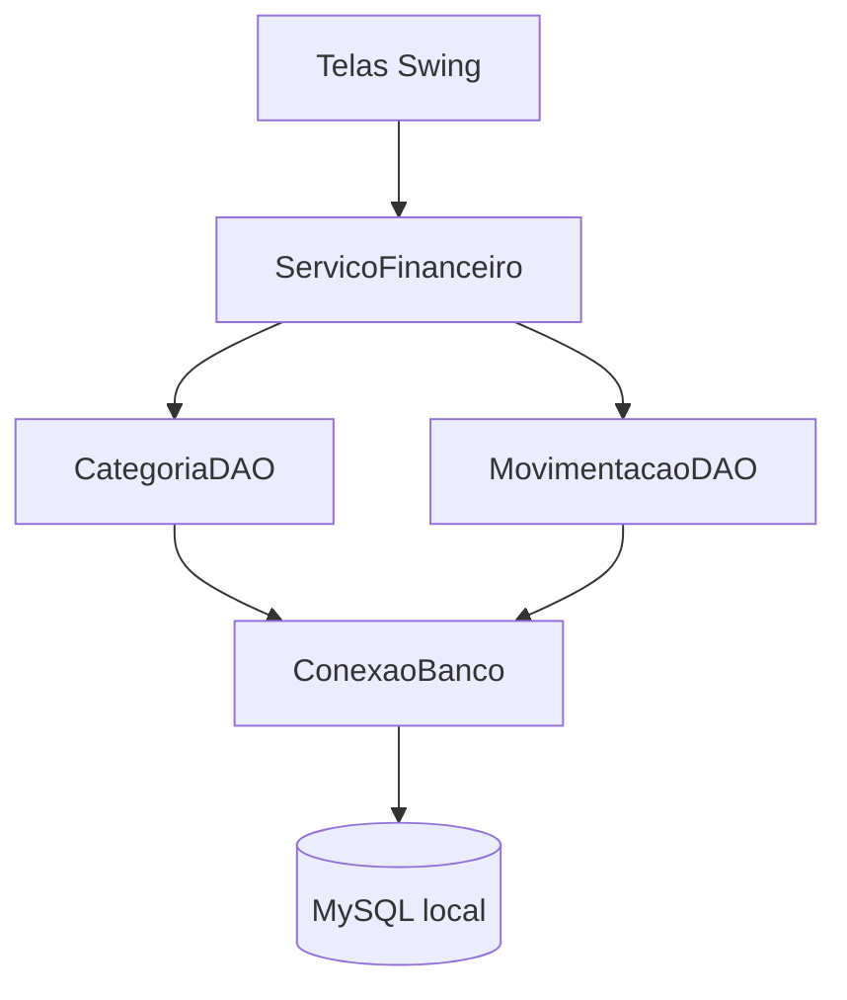
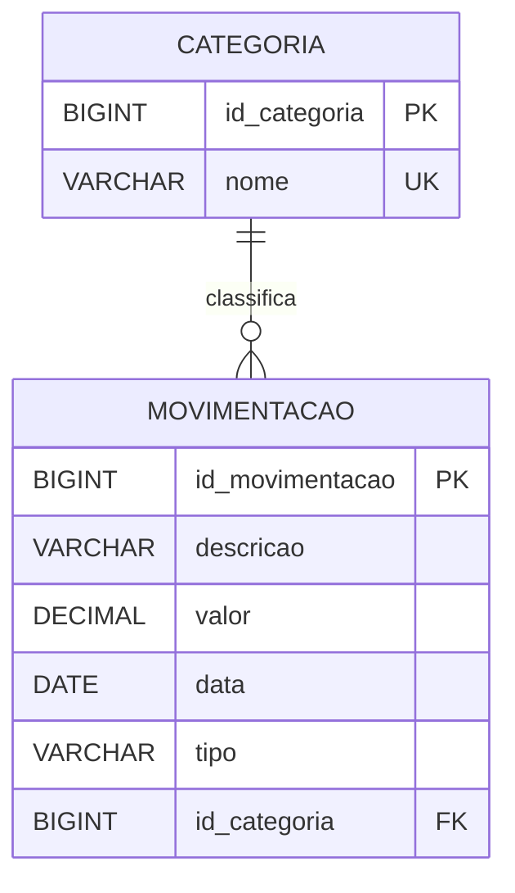
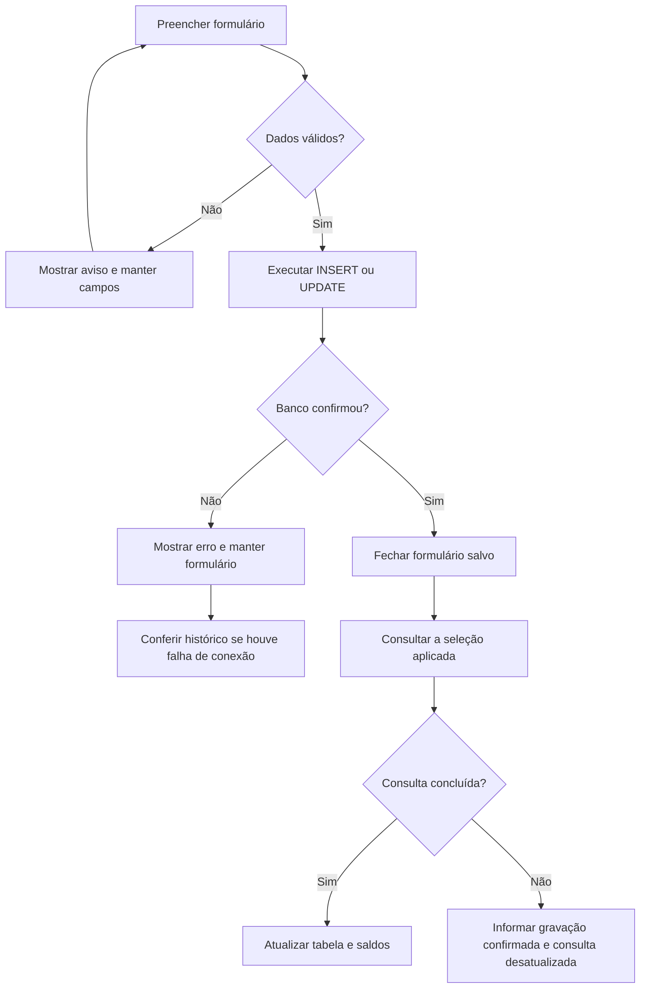

# Como o sistema foi organizado

O programa roda na máquina do usuário. A janela Swing recebe os dados, o serviço aplica as regras e as classes DAO executam SQL no MySQL. O servidor MySQL é um processo separado; fechar a janela não remove os registros.

## Desenho do sistema

| Parte | O que faz | Exemplo para explicar |
|---|---|---|
| Modelos | Guardam os dados de uma categoria, movimentação, filtro ou resumo. | Uma `Movimentacao` tem descrição, valor, data, tipo e categoria. |
| Interface | Lê campos e mostra tabelas, totais e mensagens. | `FormularioMovimentacao` transforma o texto do valor e da data em objetos. |
| Serviço | Valida informações, chama a persistência e calcula resultados. | `ServicoFinanceiro.salvar` rejeita valor zero antes de chamar o DAO. |
| DAO | Traduz uma operação em SQL e converte o resultado em objetos. | `MovimentacaoDAO.inserir` executa `INSERT` com `PreparedStatement`. |
| Conexão | Lê a configuração e abre a conexão JDBC. | `ConexaoBanco.abrir` usa `DriverManager.getConnection`. |

As telas não contêm comandos SQL. Os DAOs não decidem como exibir mensagens. O serviço pode ser testado sem abrir janelas. Essa separação permite localizar uma mudança sem misturar cálculos, SQL e componentes visuais no mesmo método.

## Modelo de dados

Uma categoria pode ter zero ou várias movimentações. Cada movimentação pertence a exatamente uma categoria. As chaves primárias são geradas pelo MySQL. A chave estrangeira impede usar uma categoria inexistente e excluir uma categoria em uso. Renomear muda somente `nome`; os vínculos são mantidos pelo identificador.

| Dado | Regra |
|---|---|
| Descrição | De 1 a 150 caracteres, após retirar espaços externos. |
| Valor | Maior que zero, até 9.999.999.999,99 e no máximo duas casas decimais. |
| Data | Data válida entre 01/01/1000 e a data atual da máquina. O limite inferior acompanha o intervalo usado pelo MySQL DATE. |
| Tipo | `RECEITA` ou `DESPESA`. O valor informado sempre é positivo. |
| Categoria | Nome de 1 a 60 caracteres, único sem diferenciar maiúsculas e minúsculas. Espaços externos são removidos antes de salvar. |
| Filtro | Datas opcionais e inclusivas; início não pode ser posterior ao fim. O fim do filtro pode estar no futuro. |

O banco usa `utf8mb4_0900_as_ci`: aceita acentos e ignora diferenças entre letras maiúsculas e minúsculas na comparação de nomes. O sufixo `as` mantém a diferença de acentuação: `Cafe` e `Café` são nomes diferentes. O tipo da movimentação usa comparação binária para aceitar apenas as duas constantes previstas.

O SQL também limita valores negativos, tipos inválidos, descrições vazias e categorias repetidas. A validação de data futura fica na aplicação. O escopo pressupõe que os registros pessoais sejam inseridos pela interface; os comandos SQL de conferência são de leitura.

## Fluxo de uma gravação

A confirmação de gravação e a atualização da tela são etapas diferentes. Se o banco confirmou o `INSERT`, o formulário é fechado antes de atualizar a consulta. Se essa consulta falhar, a mensagem continua informando que a movimentação foi salva. Se a conexão cair durante a escrita, a aplicação pede que o usuário confira o histórico antes de repetir a operação, pois o servidor pode ter recebido os dados.

Não há mecanismo automático de repetição de gravações. Essa é uma limitação intencional: repetir uma receita após uma conexão interrompida poderia duplicá-la.

## Consulta e cálculos

O DAO monta uma consulta com apenas as condições preenchidas. Os valores dos filtros são passados por `PreparedStatement`, nunca concatenados ao SQL. O resultado é percorrido com `while` e convertido em uma `ArrayList<Movimentacao>`. A ordenação usa `data DESC, id_movimentacao DESC`, incluindo um critério de desempate.

`ServicoFinanceiro.resumir` percorre essa lista. Se o tipo é receita, soma no total de receitas; caso contrário, no total de despesas. `ResumoFinanceiro.getSaldo` subtrai despesas de receitas. `resumirCategoria` repete o cálculo considerando apenas o identificador da categoria solicitado.

Todas as somas usam a mesma lista filtrada. Uma categoria sem registros nessa lista aparece com zero, mesmo que possua registros fora do filtro. Nenhum saldo é armazenado: ele é recalculado a partir das movimentações, evitando que a edição de um registro deixe um total antigo salvo no banco.

O resumo geral percorre `n` registros. O resumo das `c` categorias percorre até `n × c` registros. Essa forma é direta de explicar e suficiente para o volume de um projeto pessoal local; para bases muito grandes, seria necessário paginar consultas e considerar agregações no banco.

## Detalhes que evitam erros

| Escolha | Motivo |
|---|---|
| `BigDecimal` criado a partir de texto | Preserva valores decimais como 0,10 + 0,20 = 0,30. Não há conversão intermediária para `double`. |
| `DECIMAL(12,2)` no MySQL | Guarda os valores monetários com duas casas decimais. |
| `LocalDate` e `DATE` | Representam uma data de calendário, sem horário no lançamento. |
| `try-with-resources` | Fecha conexão, comando e resultado, inclusive quando ocorre uma exceção. |
| `PreparedStatement` | Mantém separados o comando SQL e os dados, inclusive descrições com aspas. |
| `SwingWorker` em `TarefaTela` | Executa o acesso ao banco fora da thread da interface, evitando congelar a janela durante a consulta. |
| Botões bloqueados durante a operação | Evita cliques repetidos enquanto a gravação ou consulta está em andamento. |
| Resultado completo de consulta | A tabela e os totais só são trocados depois que as consultas terminam. Falha não vira lista vazia. |
| Configuração fora do código | Permite mudar usuário, senha e porta sem recompilar. |

Uma nova conexão é aberta por operação e fechada ao final. Cada gravação modifica uma linha em uma instrução SQL, com `autocommit` do JDBC/MySQL. Não há pool de conexões nem transação envolvendo uma sequência de várias gravações. A aplicação foi projetada para uso local individual, não para edição simultânea por múltiplos usuários.

## Relação com o conteúdo estudado

| Conteúdo | Onde aparece no código |
|---|---|
| Álgebra | Soma de receitas e despesas e diferença que produz o saldo, em `ResumoFinanceiro`. |
| Algoritmos e condições | Validação de entradas, escolha entre INSERT/UPDATE e decisão entre receita/despesa, em `ServicoFinanceiro`. |
| Repetição | Leitura do `ResultSet` e percurso das listas para calcular os totais. |
| Modularização | Métodos com tarefas específicas e separação em interface, serviço, modelo e persistência. |
| POO e encapsulamento | Classes com atributos privados, construtores e métodos de acesso. Uma movimentação contém uma categoria. |
| Listas | `ArrayList` nos DAOs e `List<Movimentacao>` nos cálculos e na apresentação. |
| SQL | Tabelas, chaves, restrições, JOIN, filtros e operações de cadastro, consulta, atualização e exclusão. |
| JDBC | `Connection`, `PreparedStatement`, `ResultSet`, `executeQuery` e `executeUpdate`. |
| Interface | Formulários, eventos de botões, tabelas, seleção de linhas e mensagens. |

O material de modularização, listas, POO e JDBC/MySQL orientou a divisão. Não foi forçado o uso de matrizes, grafos ou herança apenas para marcar conteúdos. A relação entre movimentação e categoria é composição de objetos; as subclasses de componentes Swing decorrem da construção da interface.

`BigDecimal`, `LocalDate`, `SwingWorker`, Maven e JUnit complementam os conteúdos centrais. Cada um resolve uma necessidade concreta: precisão de valores, validação de datas, resposta da interface, execução reproduzível e verificação do programa. O roteiro de apresentação destaca os métodos que precisam ser entendidos primeiro.
